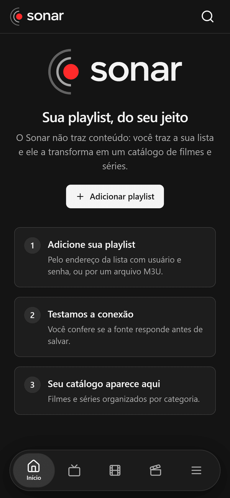
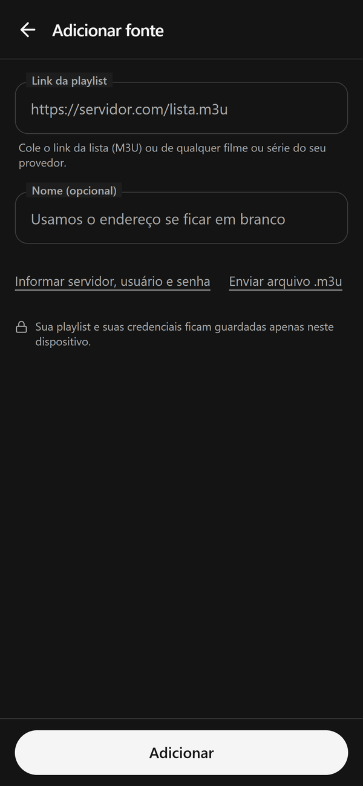
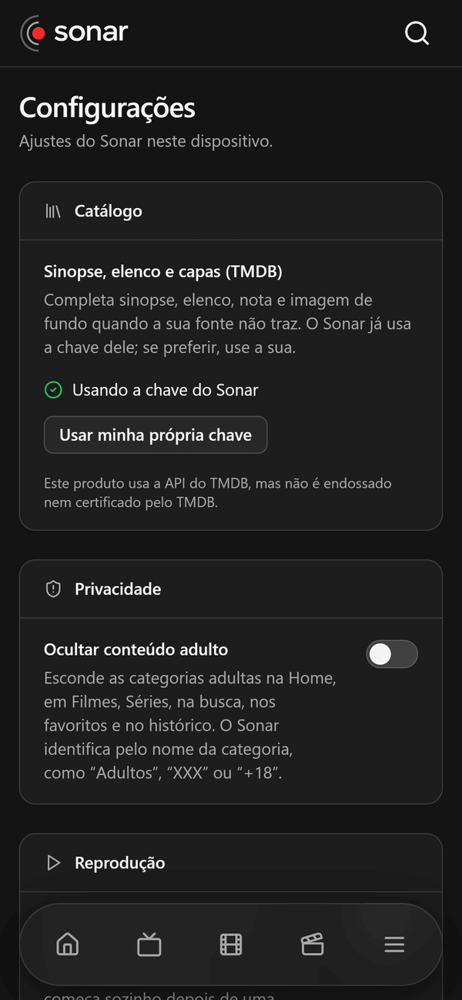
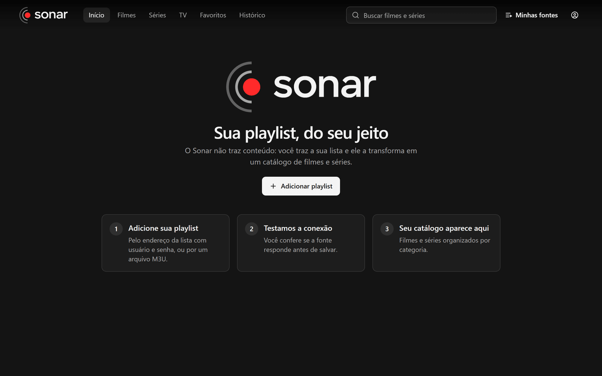

<p align="center">
  
</p>

<h1 align="center">Sonar</h1>

<p align="center">
  <b>Seus filmes, séries e animes em um só lugar.</b><br>
  Um player para a sua playlist: capas, temporadas, histórico e favoritos,<br>
  no celular, no PC e, em breve, na TV.
</p>

<p align="center">
  <a href="https://github.com/GabryelKadmo/sonar-download/releases/latest"></a>
  <a href="https://github.com/GabryelKadmo/sonar-download/releases"></a>
  
</p>

---

## Baixar

| Plataforma | Download | Requisitos |
| --- | --- | --- |
| **Android** | [Sonar.apk](https://github.com/GabryelKadmo/sonar-download/releases/latest/download/Sonar.apk) | Android 7.0 ou superior |
| **Windows** | [Sonar-Setup.exe](https://github.com/GabryelKadmo/sonar-download/releases/latest/download/Sonar-Setup.exe) | Windows 10 ou 11, 64 bits |
| **Navegador** | [Abrir o Sonar](https://sonar-streaming.vercel.app) | Qualquer navegador moderno |
| **TV (LG webOS)** | Em breve | |

> Versão atual: **0.1.0**. As notas de cada versão e os checksums (`SHA256SUMS.txt`) estão em [Releases](https://github.com/GabryelKadmo/sonar-download/releases).

### Como instalar

**Android**
1. Baixe o `Sonar.apk` pelo navegador do celular.
2. Quando o Android pedir, permita **instalar apps desconhecidos** para esse navegador.
3. Abra o arquivo baixado e toque em **Instalar**. Se o Play Protect avisar que o app não é conhecido, escolha **Instalar assim mesmo**: o Sonar ainda não está na Play Store.

**Windows**
1. Baixe e abra o `Sonar-Setup`.
2. Se o SmartScreen mostrar "O Windows protegeu o seu PC", clique em **Mais informações** e depois em **Executar assim mesmo**. O instalador ainda não tem assinatura de código.

### Conferir a autenticidade do APK

O APK é assinado com a chave do Sonar. Para conferir, rode no PC com o Android SDK:

```bash
apksigner verify --print-certs Sonar.apk
```

O certificado tem que ser este (`CN=Sonar, OU=Deepsea Studio`):

```
SHA-256: 02:09:66:A1:C0:EB:C8:C7:84:91:14:D1:5B:D1:D7:DB:18:58:82:E2:27:38:F7:91:4B:AE:0A:D6:7D:F0:8A:EE
```

Se for diferente, não instale.

---

## O que é

O Sonar **não traz conteúdo**: você traz a sua lista e ele a transforma em um catálogo de filmes e séries.

1. **Adicione a sua playlist**: pelo link da lista (M3U), por servidor, usuário e senha, ou enviando um arquivo.
2. **Testamos a conexão** antes de salvar.
3. **Seu catálogo aparece**, organizado por categoria, com capas e sinopses.

<table>
  <tr>
    <td align="center"></td>
    <td align="center"></td>
    <td align="center"></td>
  </tr>
</table>

<p align="center">
  
</p>

## Recursos

- **Catálogo de filmes, séries e animes** com capas, sinopses, elenco e temporadas
- **Continuar assistindo**, histórico e favoritos
- **TV ao vivo**, com favoritos, categorias e, no Android, player nativo
- **Pular intro e créditos** nos episódios, quando a informação está disponível
- **Busca rápida**, mesmo em listas com dezenas de milhares de itens
- **Vários aparelhos**: entre com a sua conta (código por e-mail) para sincronizar as playlists entre celular, PC e navegador
- **Tema escuro**, com navegação por teclado

## Privacidade

- Sua playlist e suas credenciais ficam guardadas **apenas no seu aparelho**.
- Só quem entra na conta tem as playlists no servidor, e sempre **cifradas**.
- A conta é opcional: o Sonar funciona inteiro sem ela.

## Aviso legal

O Sonar é apenas um player. Ele **não fornece, não hospeda e não indica** conteúdo de nenhum tipo. Use somente playlists e conteúdos que você tem o direito de acessar.

## Problemas e sugestões

Achou um erro ou tem uma ideia? Abra uma [issue](https://github.com/GabryelKadmo/sonar-download/issues/new) dizendo a plataforma, a versão e o que aconteceu. Não cole links ou senhas da sua playlist.

## Licença

Sonar © 2026 Deepsea Studio. O aplicativo é distribuído gratuitamente, sem garantias. O código-fonte é privado.

<p align="center"><sub>Feito por <b>Deepsea Studio</b></sub></p>
